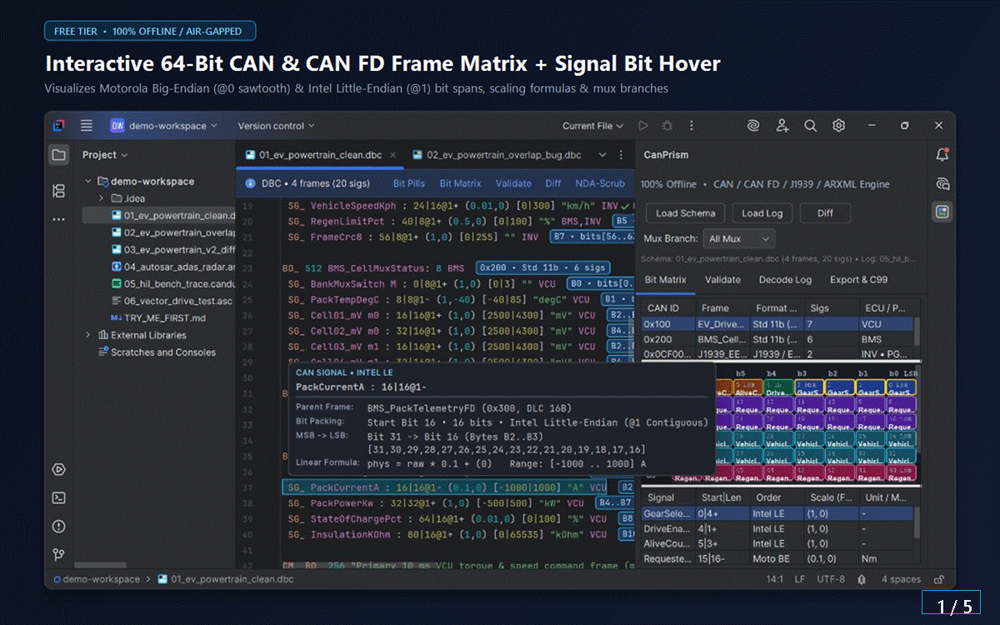

# CanPrism DBC ARXML Viewer — Offline CAN / CAN FD, J1939 & AUTOSAR Inspector for JetBrains IDEs

[-087CFA)](https://plugins.jetbrains.com/plugin/36115-canprism-dbc-arxml-viewer)

**Deterministic, 100% offline / air-gapped automotive & embedded `CAN / CAN FD Database` (`.dbc`), `AUTOSAR Network Description` (`.arxml`), and `SAE J1939 / SocketCAN` inspector featuring an interactive `64-bit / 512-bit Motorola & Intel Frame Bit-Packing Matrix`, signal bit-overlap validator, semantic `Ctrl+D` network diff, raw `candump`/`.asc` physical decoder, and clean-room `C99` codec generator across all JetBrains IDEs** (`CLion`, `PyCharm`, `RustRover`, `IntelliJ IDEA`, `Rider`, `DataGrip`, `GoLand`, `WebStorm`).

Built for EV powertrain, ADAS, battery management (`BMS`), robotics, drone, heavy-machinery (`SAE J1939`), and Tier-1 automotive firmware/HIL engineers barred by **OEM NDAs, UNECE `WP.29 R155` cybersecurity rules, or ITAR** from pasting proprietary `.dbc` / `.arxml` signal matrices into web viewers or cloud AI tools.

- **100% Local & Air-Gapped:** Zero backend servers, zero databases, zero telemetry, zero cloud or LLM API calls.
- **Cross-IDE Pure Platform:** Depends strictly on `com.intellij.modules.platform` — runs identically in `CLion`, `PyCharm`, `RustRover`, `IntelliJ IDEA`, `Rider`, `DataGrip`, `GoLand`, and `WebStorm` (`2025.1`+).

---

## Installation

- **JetBrains Marketplace (`#36115`):** **[Install `CanPrism DBC ARXML Viewer` from JetBrains Marketplace ->](https://plugins.jetbrains.com/plugin/36115-canprism-dbc-arxml-viewer)**
- **Inside Any JetBrains IDE (`2025.1+`):** Open **Settings / Preferences** (`Ctrl+Alt+S` / `Cmd+,`) -> **Plugins** -> **Marketplace** -> search **`CanPrism DBC ARXML Viewer`** -> click **Install** (dynamic plugin — zero IDE restart required).

---

## Free Tier vs. `[Pro]` Feature Matrix

| Capability | Free Tier | `[Pro]` Tier (14-Day Free Trial) |
| :--- | :---: | :---: |
| **`.dbc`, `.arxml` & `.candump` Syntax Highlighting & Inline Bit-Span Pills** | Yes | Yes |
| **Hover & `Ctrl+Q` Cards (Motorola `@0` Sawtooth vs. Intel `@1` LE, `MSB->LSB` Range, Scaling Formula, `VAL_` Enums, `J1939 PGN`)** | Yes | Yes |
| **Interactive 2D `8x8` (`64`-Bit CAN) & `64`-Byte (`CAN FD`) Frame Bit-Packing Matrix with Mux (`M`/`m0..mN`) Filter & Caret Sync** | Yes | Yes |
| **Searchable CAN Frame & Signal Explorer (`TableSpeedSearch`)** | Yes | Yes |
| **Zero Startup Nag Modals** | Yes | Yes |
| **Signal Bit-Overlap, `DLC` Byte Overflow & Multiplexor Collision Validator** | — | **Yes** |
| **Semantic `.dbc` & `.arxml` Network Diff (`Alt+Shift+B` & Native `Ctrl+D`) Stripping `BA_`/`CM_` Order & XML `UUID` Churn** | — | **Yes** |
| **Streaming `AUTOSAR 4.x` `.arxml` Flattener & 1-Click `.arxml -> .dbc` Converter** | — | **Yes** |
| **Offline `candump` & Vector `.asc` Raw Hex Bus Trace Decoder + Live Byte-to-Signal Hover Cards** | — | **Yes** |
| **1-Click Clean-Room `C99` Header (`.h`), JSON/CSV Matrix Exporter & `HmacSHA256` NDA Scrubber (`Alt+Shift+R`)** | — | **Yes** |

---

## Quick Keyboard Shortcuts & Workflow

- **Hover Any `BO_` / `SG_` or `<I-SIGNAL>` Line (or Press `Ctrl + Q`):** Inspect exact `Start Bit`, `MSB -> LSB` bit indices (`@0` Motorola sawtooth vs. `@1` Intel contiguous), linear formula (`phys = raw * factor + offset`), `VAL_` enums, and 29-bit `SAE J1939` `PGN` / Priority / Source Address.
- **Click Any Bit Cell in the 2D `Bit Matrix`:** Highlights the entire signal across byte rows (`[MSB]`, `[LSB]`, or red `!OVR` on bit collisions) and jumps the `.dbc` / `.arxml` editor straight to that signal's definition.
- **`Alt + Shift + B`** *(or select two `.dbc` / `.arxml` files in Project View and press **`Ctrl + D`**)*: Launch **Semantic Network Diff `[Pro]`**, comparing frames sorted by CAN ID and bit layout without `BA_`/`CM_` attribute re-ordering or AUTOSAR `UUID` noise.
- **Hover Individual Hex Bytes in `.candump` / `.asc` Logs:** Highlights all payload bytes spanned by the signal and previews decoded physical engineering units (`Nm`, `km/h`, `kW`, `degC`, `VAL_` states).
- **`Alt + Shift + R`:** Run **Export NDA-Scrubbed DBC Test Fixture `[Pro]`**, deterministically anonymizing OEM ECU, frame, and signal identifiers via local `HmacSHA256` while keeping 100% identical CAN IDs, DLCs, bit positions, and scaling.

---

## Automotive CAN / AUTOSAR Engineering Guides

- **[Motorola Big-Endian (`@0` Sawtooth) vs. Intel Little-Endian (`@1`) CAN Bit Numbering Explained](./guides/motorola-big-endian-vs-intel-little-endian-can-bit-numbering.md)**
- **[Decoding 29-Bit `SAE J1939` Arbitration IDs into Priority, `PDU1`/`PDU2`, `PGN`, and Source Address](./guides/sae-j1939-29-bit-can-id-to-pgn-decoding.md)**

---

## Sister Plugins in the EdiPrism Air-Gapped Suite

- **[EdiPrism X12 EDIFACT (`#35990`)](https://plugins.jetbrains.com/plugin/35990-ediprism-x12-edifact):** 100% offline `ASC X12` & `UN/EDIFACT` loop inspector, semantic diff, `BigDecimal` balancing validator, and HIPAA Safe Harbor scrubber ([GitHub Docs](https://github.com/EdiPrism/ediprism)).
- **[EbcdicPrism Copybook Viewer (`#36104`)](https://plugins.jetbrains.com/plugin/36104-ebcdicprism-copybook-viewer):** 100% offline `COBOL Copybook` (`.cpy`), binary `EBCDIC` / `COMP-3` record overlay, `S0C7` validator, and `PCI-DSS` binary scrubber ([GitHub Docs](https://github.com/EdiPrism/ebcdicprism)).

---

## Legal, Privacy & Support

- **Privacy & Air-Gapped Security Attestation:** [PRIVACY.md](./PRIVACY.md) • [ediprism.github.io/privacy.html](https://ediprism.github.io/privacy.html)
- **End-User License Agreement (EULA):** [EULA.md](./EULA.md) • [ediprism.github.io/eula.html](https://ediprism.github.io/eula.html)
- **Release Notes:** [CHANGELOG.md](./CHANGELOG.md)
- **Bug Reports & Feature Requests:** [GitHub Issues](https://github.com/EdiPrism/canprism/issues) • [Support Hub](https://ediprism.github.io/support.html)

*AUTOSAR is a registered trademark of the AUTOSAR Development Partnership. CAN and CAN FD are standardized under ISO 11898. CanPrism is an independent clean-room developer tool by EdiPrism and is not affiliated with, endorsed by, or sponsored by Vector Informatik GmbH, the AUTOSAR Development Partnership, SAE International, or JetBrains s.r.o.*
